# Diagramas modulares del modelo de datos de AutoDrive (SARV) en Mermaid

# Módulo A: Clientes, reseñas y reservas

## Módulo A – Modelo conceptual

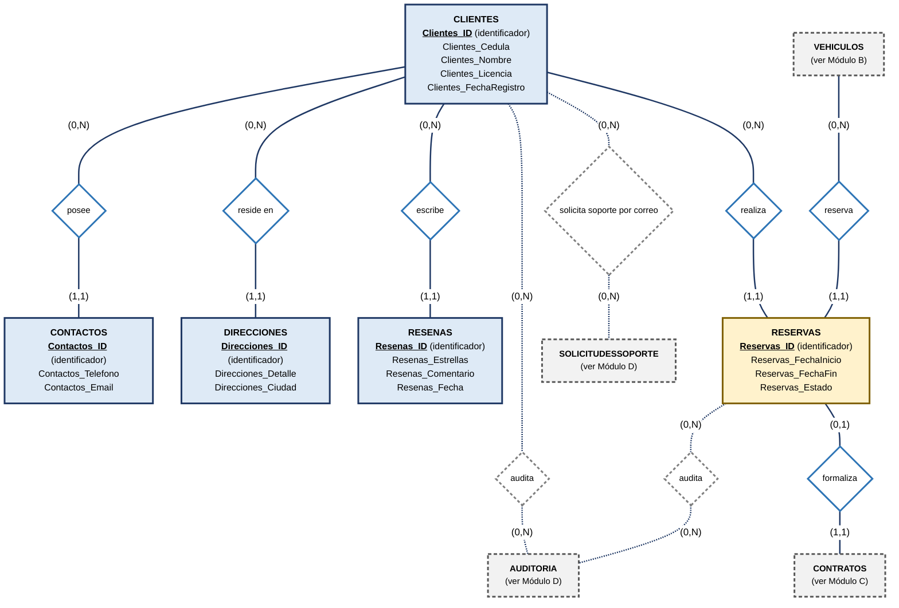

## Módulo A – Modelo lógico

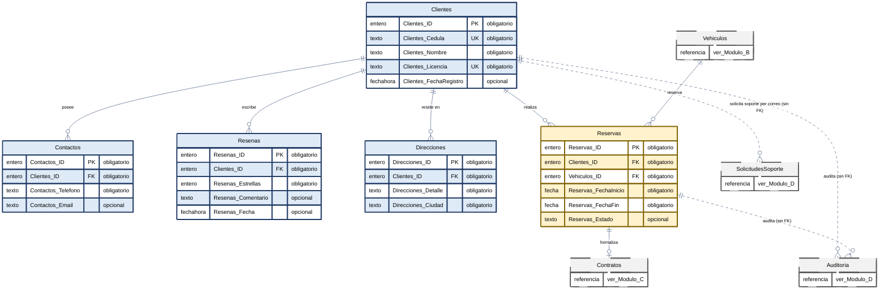

## Módulo A – Modelo físico

```mermaid
%%{init: {"theme":"base","themeVariables":{"fontSize":"18px","fontFamily":"Arial","primaryColor":"#DEEAF6","primaryTextColor":"#000000","primaryBorderColor":"#1F3864","lineColor":"#1F3864","secondaryColor":"#FFF2CC","tertiaryColor":"#FFFFFF","edgeLabelBackground":"#FFFFFF","attributeBackgroundColorOdd":"#FFFFFF","attributeBackgroundColorEven":"#EAF1FB"}}}%%
erDiagram
    Clientes ||--o{ Contactos : "posee"
    Clientes ||--o{ Resenas : "escribe"
    Clientes ||--o{ Direcciones : "reside en"
    Clientes ||--o{ Reservas : "realiza"
    Vehiculos ||--o{ Reservas : "reserva"
    Reservas ||--o| Contratos : "formaliza"
    Clientes ||..o{ Auditoria : "audita (sin FK)"
    Reservas ||..o{ Auditoria : "audita (sin FK)"
    Clientes ||..o{ SolicitudesSoporte : "solicita soporte por correo (sin FK)"

    Clientes {
        INT Clientes_ID PK "NOT NULL autoincremental"
        VARCHAR(15) Clientes_Cedula UK "NOT NULL"
        VARCHAR(100) Clientes_Nombre "NOT NULL"
        VARCHAR(20) Clientes_Licencia UK "NOT NULL"
        DATETIME Clientes_FechaRegistro "NULL DEFAULT CURRENT_TIMESTAMP"
    }
    Contactos {
        INT Contactos_ID PK "NOT NULL autoincremental"
        INT Clientes_ID FK "NOT NULL"
        VARCHAR(15) Contactos_Telefono "NOT NULL"
        VARCHAR(100) Contactos_Email "NULL"
    }
    Direcciones {
        INT Direcciones_ID PK "NOT NULL autoincremental"
        INT Clientes_ID FK "NOT NULL"
        VARCHAR(150) Direcciones_Detalle "NOT NULL"
        VARCHAR(50) Direcciones_Ciudad "NOT NULL"
    }
    Resenas {
        INT Resenas_ID PK "NOT NULL autoincremental"
        INT Clientes_ID FK "NOT NULL"
        INT Resenas_Estrellas "NOT NULL"
        VARCHAR(255) Resenas_Comentario "NULL"
        DATETIME Resenas_Fecha "NULL DEFAULT CURRENT_TIMESTAMP"
    }
    Reservas {
        INT Reservas_ID PK "NOT NULL autoincremental"
        INT Clientes_ID FK "NOT NULL"
        INT Vehiculos_ID FK "NOT NULL"
        DATE Reservas_FechaInicio "NOT NULL"
        DATE Reservas_FechaFin "NOT NULL"
        VARCHAR(20) Reservas_Estado "NULL DEFAULT Pendiente"
    }
    Auditoria {
        referencia ver_Modulo_D
    }
    Contratos {
        referencia ver_Modulo_C
    }
    SolicitudesSoporte {
        referencia ver_Modulo_D
    }
    Vehiculos {
        referencia ver_Modulo_B
    }

    style Auditoria fill:#F2F2F2,stroke:#595959,stroke-width:3px,stroke-dasharray:6 4,color:#000000
    style Clientes fill:#DEEAF6,stroke:#1F3864,stroke-width:3px,color:#000000
    style Contactos fill:#DEEAF6,stroke:#1F3864,stroke-width:3px,color:#000000
    style Contratos fill:#F2F2F2,stroke:#595959,stroke-width:3px,stroke-dasharray:6 4,color:#000000
    style Direcciones fill:#DEEAF6,stroke:#1F3864,stroke-width:3px,color:#000000
    style Resenas fill:#DEEAF6,stroke:#1F3864,stroke-width:3px,color:#000000
    style Reservas fill:#FFF2CC,stroke:#7F6000,stroke-width:3px,color:#000000
    style SolicitudesSoporte fill:#F2F2F2,stroke:#595959,stroke-width:3px,stroke-dasharray:6 4,color:#000000
    style Vehiculos fill:#F2F2F2,stroke:#595959,stroke-width:3px,stroke-dasharray:6 4,color:#000000
```

# Módulo B: Flota de vehículos

## Módulo B – Modelo conceptual

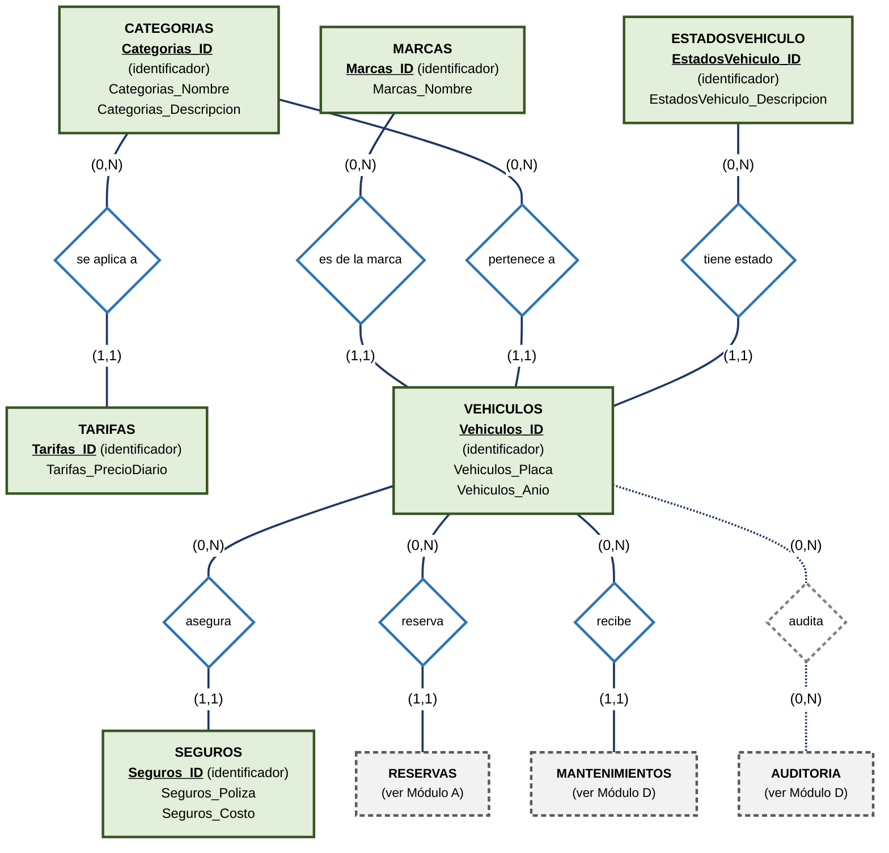

## Módulo B – Modelo lógico

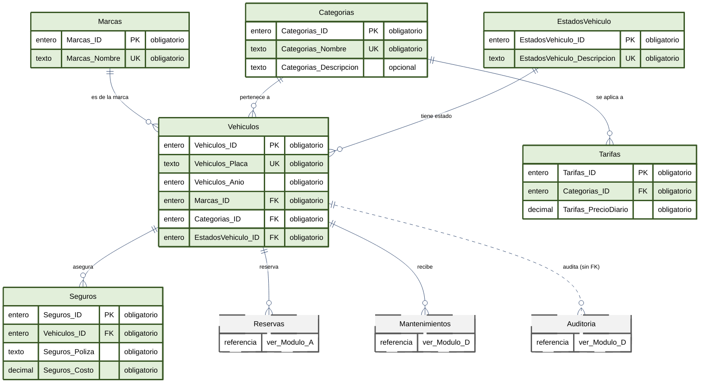

## Módulo B – Modelo físico

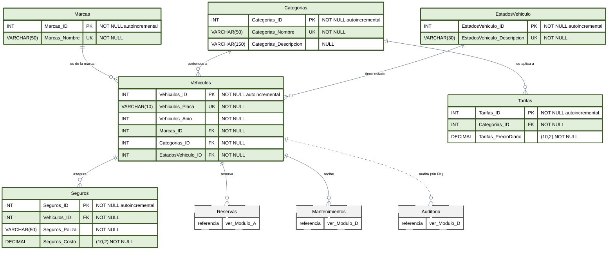

# Módulo C: Contratación, facturación y pagos

## Módulo C – Modelo conceptual

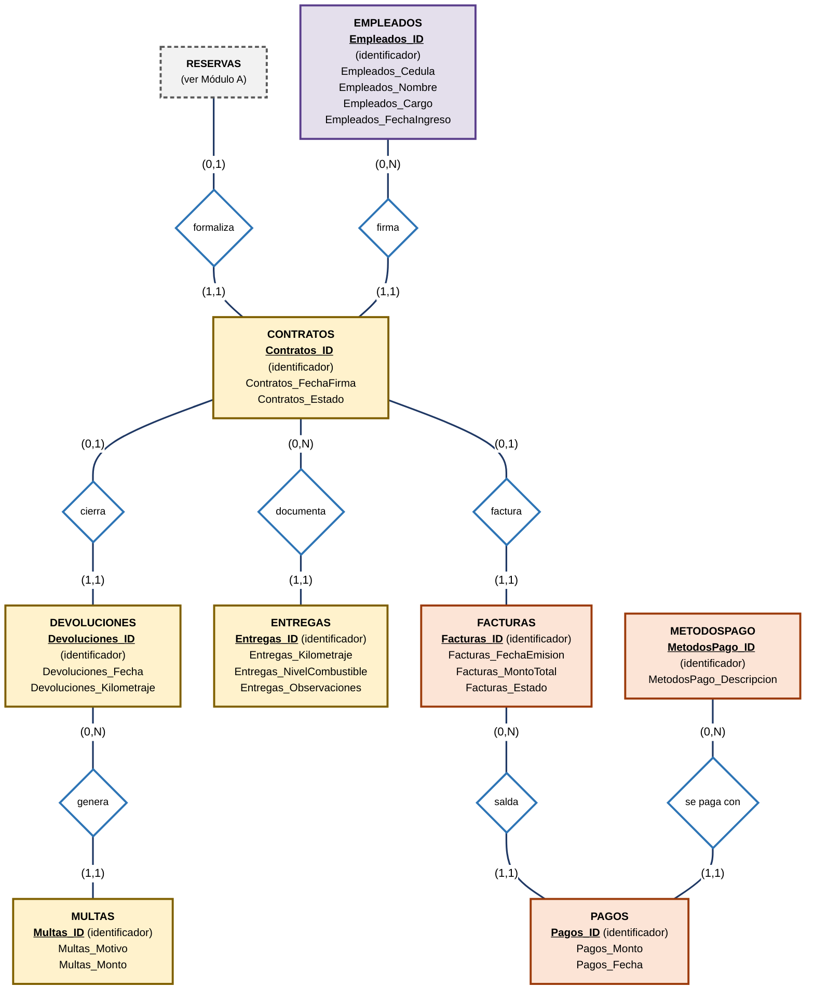

## Módulo C – Modelo lógico

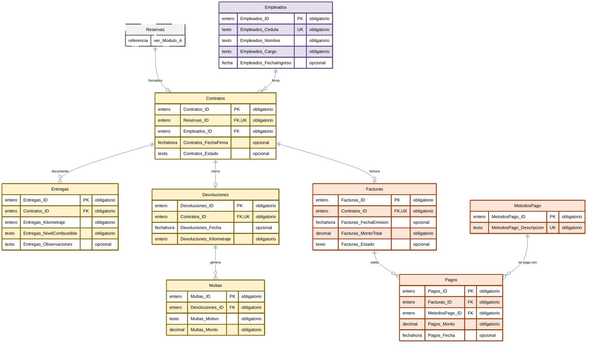

## Módulo C – Modelo físico

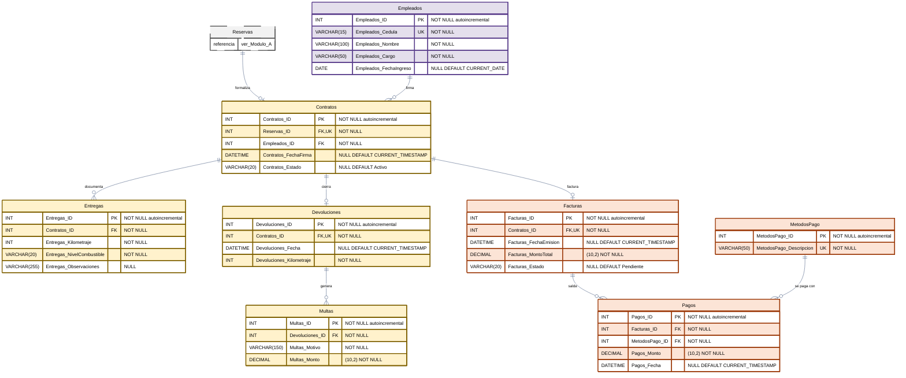

# Módulo D: Taller, seguridad, auditoría y soporte

## Módulo D – Modelo conceptual

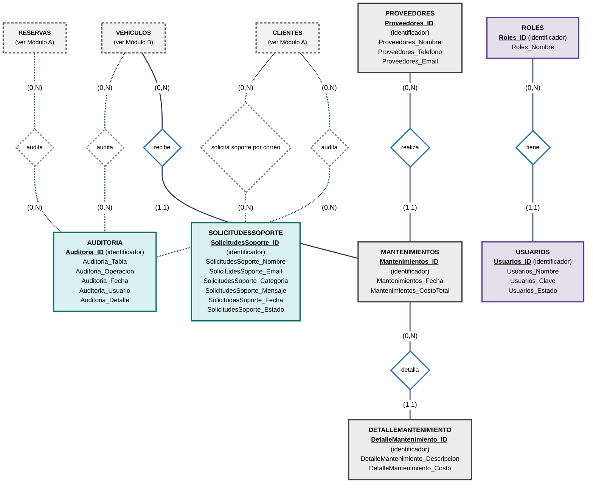

## Módulo D – Modelo lógico

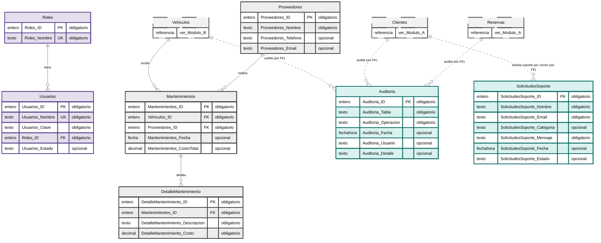

## Módulo D – Modelo físico

```mermaid
%%{init: {"theme":"base","themeVariables":{"fontSize":"18px","fontFamily":"Arial","primaryColor":"#DEEAF6","primaryTextColor":"#000000","primaryBorderColor":"#1F3864","lineColor":"#1F3864","secondaryColor":"#FFF2CC","tertiaryColor":"#FFFFFF","edgeLabelBackground":"#FFFFFF","attributeBackgroundColorOdd":"#FFFFFF","attributeBackgroundColorEven":"#EAF1FB"}}}%%
erDiagram
    Roles ||--o{ Usuarios : "tiene"
    Vehiculos ||--o{ Mantenimientos : "recibe"
    Proveedores ||--o{ Mantenimientos : "realiza"
    Mantenimientos ||--o{ DetalleMantenimiento : "detalla"
    Vehiculos ||..o{ Auditoria : "audita (sin FK)"
    Clientes ||..o{ Auditoria : "audita (sin FK)"
    Reservas ||..o{ Auditoria : "audita (sin FK)"
    Clientes ||..o{ SolicitudesSoporte : "solicita soporte por correo (sin FK)"

    Auditoria {
        INT Auditoria_ID PK "NOT NULL autoincremental"
        VARCHAR(50) Auditoria_Tabla "NOT NULL"
        VARCHAR(20) Auditoria_Operacion "NOT NULL"
        DATETIME Auditoria_Fecha "NULL DEFAULT CURRENT_TIMESTAMP"
        VARCHAR(50) Auditoria_Usuario "NULL"
        VARCHAR(255) Auditoria_Detalle "NULL"
    }
    DetalleMantenimiento {
        INT DetalleMantenimiento_ID PK "NOT NULL autoincremental"
        INT Mantenimientos_ID FK "NOT NULL"
        VARCHAR(150) DetalleMantenimiento_Descripcion "NOT NULL"
        DECIMAL DetalleMantenimiento_Costo "(10,2) NOT NULL"
    }
    Mantenimientos {
        INT Mantenimientos_ID PK "NOT NULL autoincremental"
        INT Vehiculos_ID FK "NOT NULL"
        INT Proveedores_ID FK "NOT NULL"
        DATE Mantenimientos_Fecha "NULL DEFAULT CURRENT_DATE"
        DECIMAL Mantenimientos_CostoTotal "(10,2) NULL DEFAULT 0.00"
    }
    Proveedores {
        INT Proveedores_ID PK "NOT NULL autoincremental"
        VARCHAR(100) Proveedores_Nombre "NOT NULL"
        VARCHAR(15) Proveedores_Telefono "NULL"
        VARCHAR(100) Proveedores_Email "NULL"
    }
    Roles {
        INT Roles_ID PK "NOT NULL autoincremental"
        VARCHAR(50) Roles_Nombre UK "NOT NULL"
    }
    SolicitudesSoporte {
        INT SolicitudesSoporte_ID PK "NOT NULL autoincremental"
        VARCHAR(100) SolicitudesSoporte_Nombre "NOT NULL"
        VARCHAR(100) SolicitudesSoporte_Email "NOT NULL"
        VARCHAR(50) SolicitudesSoporte_Categoria "NULL DEFAULT Otro"
        VARCHAR(500) SolicitudesSoporte_Mensaje "NOT NULL"
        DATETIME SolicitudesSoporte_Fecha "NULL DEFAULT CURRENT_TIMESTAMP"
        VARCHAR(20) SolicitudesSoporte_Estado "NULL DEFAULT Pendiente"
    }
    Usuarios {
        INT Usuarios_ID PK "NOT NULL autoincremental"
        VARCHAR(50) Usuarios_Nombre UK "NOT NULL"
        VARCHAR(255) Usuarios_Clave "NOT NULL"
        INT Roles_ID FK "NOT NULL"
        VARCHAR(20) Usuarios_Estado "NULL DEFAULT Activo"
    }
    Clientes {
        referencia ver_Modulo_A
    }
    Reservas {
        referencia ver_Modulo_A
    }
    Vehiculos {
        referencia ver_Modulo_B
    }

    style Auditoria fill:#D9F2F0,stroke:#0B6B63,stroke-width:3px,color:#000000
    style Clientes fill:#F2F2F2,stroke:#595959,stroke-width:3px,stroke-dasharray:6 4,color:#000000
    style DetalleMantenimiento fill:#EDEDED,stroke:#404040,stroke-width:3px,color:#000000
    style Mantenimientos fill:#EDEDED,stroke:#404040,stroke-width:3px,color:#000000
    style Proveedores fill:#EDEDED,stroke:#404040,stroke-width:3px,color:#000000
    style Reservas fill:#F2F2F2,stroke:#595959,stroke-width:3px,stroke-dasharray:6 4,color:#000000
    style Roles fill:#E4DFEC,stroke:#5B3F8C,stroke-width:3px,color:#000000
    style SolicitudesSoporte fill:#D9F2F0,stroke:#0B6B63,stroke-width:3px,color:#000000
    style Usuarios fill:#E4DFEC,stroke:#5B3F8C,stroke-width:3px,color:#000000
    style Vehiculos fill:#F2F2F2,stroke:#595959,stroke-width:3px,stroke-dasharray:6 4,color:#000000
```

